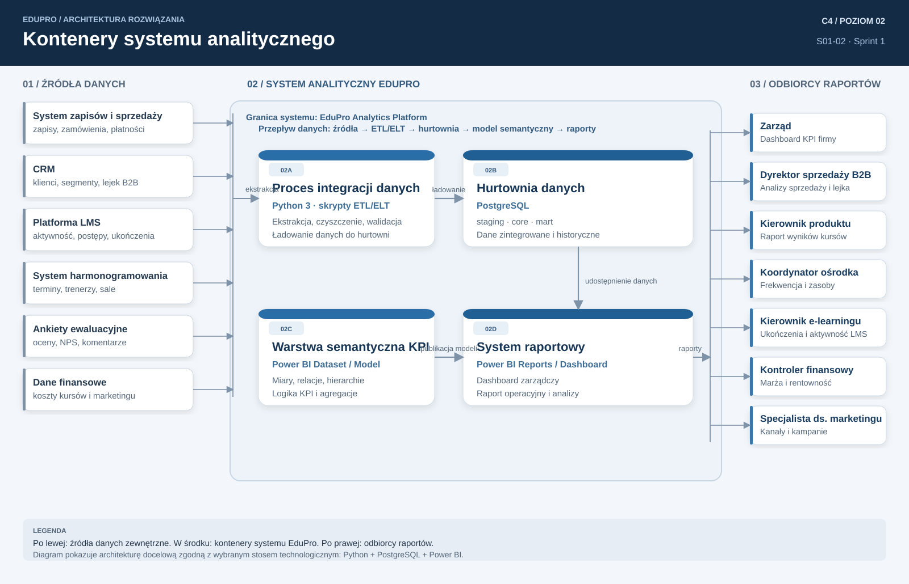

# C4 – Container: system analityczny EduPro

**Zadanie:** S01-02  
**Sprint:** 1  
**Epika:** Architektura rozwiązania  
**Priorytet:** Must have  
**Status architektury:** projekt do uzgodnienia z zespołem

## Cel i zakres

Diagram C4 Container przedstawia techniczną architekturę rozwiązania analitycznego EduPro. Pokazuje główne kontenery systemu, przepływ informacji między nimi oraz wybrane technologie: **Python** do integracji danych, **PostgreSQL** jako hurtownię danych oraz **Power BI** jako warstwę semantyczną i raportową. Diagram jest rozwinięciem wcześniej opracowanego poziomu **C4 Context**.

## Diagram C4 Container

**Notacja:** diagram równoważny C4 Container. Kontenery wewnątrz granicy systemu EduPro pokazują elementy rozwiązania technicznego. Po lewej stronie przedstawiono zewnętrzne źródła danych, a po prawej odbiorców raportów biznesowych.

## Opis kontenerów systemu

| Kontener | Technologia | Rola w rozwiązaniu |
|---|---|---|
| Proces integracji danych (ETL/ELT) | Python | Pobiera dane ze źródeł, czyści je, waliduje i ładuje do hurtowni. Odpowiada za logikę integracji i transformacji. |
| Hurtownia danych | PostgreSQL | Przechowuje dane analityczne w strefach `staging`, `core` i `mart`. Udostępnia dane do analiz i raportowania. |
| Warstwa semantyczna KPI | Power BI Dataset / Model | Definiuje miary biznesowe, relacje, hierarchie oraz logikę KPI wykorzystywaną w raportach. |
| System raportowy | Power BI Reports / Dashboard | Prezentuje dashboard zarządczy i raporty operacyjne dla użytkowników biznesowych. |

## Źródła danych ujęte na diagramie

| Źródło | Typ danych / przykład |
|---|---|
| System zapisów i sprzedaży | zapisy, zamówienia, płatności, zwroty |
| CRM | klienci B2B/B2C, segmentacja, lejek sprzedaży |
| Platforma LMS | logi aktywności, postępy, quizy, ukończenia |
| System harmonogramowania | terminy, trenerzy, sale, lokalizacje |
| Narzędzie ankiet ewaluacyjnych | oceny, NPS, odpowiedzi uczestników |
| Dane finansowe | koszty trenerów, sal, cateringu, licencji, marketingu |

## Przepływ informacji

1. **Źródła danych** dostarczają dane operacyjne i plikowe do procesu ETL/ELT.
2. **Proces ETL/ELT w Pythonie** pobiera dane, wykonuje czyszczenie, walidację i transformacje oraz zapisuje wynik do hurtowni.
3. **Hurtownia danych w PostgreSQL** przechowuje zintegrowane dane w modelu analitycznym i udostępnia je do warstwy semantycznej.
4. **Warstwa semantyczna Power BI** oblicza KPI, agregacje i logikę biznesową.
5. **Raporty i dashboardy Power BI** prezentują wyniki użytkownikom biznesowym.

## Spójność z diagramem C4 Context

Diagram Container rozwija system „System analityczny EduPro” z poziomu Context na szczegółowe kontenery techniczne. Zachowuje te same główne źródła danych oraz tych samych odbiorców biznesowych, ale dodaje widok implementacyjny: ETL/ELT, hurtownię danych, warstwę semantyczną i raportową.

## Powiązanie z wymaganiami projektu

Diagram wspiera realizację wymagań z dokumentu projektowego, w szczególności:

- **Rozdział 6** – wymagane warstwy architektury rozwiązania.
- **R-01** – zasilenie hurtowni z minimum 3 źródeł w różnych formatach.
- **R-02** – czyszczenie i walidacja danych.
- **R-03** – model wymiarowy zgodny z wymaganiami.
- **R-04** – miary KPI.
- **R-05** – dashboard zarządczy.
- **R-06** – raport operacyjny.
- **NFR-04** – wersjonowanie kodu i artefaktów w repozytorium Git.
- **NFR-05** – odtwarzalność rozwiązania i czytelna dokumentacja.

## Weryfikacja kryteriów akceptacji

| Kryterium | Sposób weryfikacji |
|---|---|
| Diagram przedstawia wszystkie wymagane warstwy | Na diagramie widoczne są źródła danych, ETL/ELT, hurtownia danych, warstwa semantyczna i system raportowy |
| Pokazuje przepływ informacji między komponentami | Strzałki i opisy relacji pokazują kolejność przepływu danych od źródeł do raportów |
| Uwzględnia wybrane technologie | Kontenery opisano technologiami Python, PostgreSQL i Power BI |
| Jest spójny z diagramem C4 Context | Zachowano te same główne źródła danych i odbiorców biznesowych oraz rozwinięto system EduPro do poziomu kontenerów |

## Decyzje i ograniczenia

- Przyjęto **Python** jako technologię ETL/ELT, ponieważ został wskazany przez zespół jako technologia projektowa.
- Przyjęto **PostgreSQL** jako centralną warstwę składowania danych.
- Przyjęto **Power BI** jako warstwę semantyczną i raportową.
- Nie pokazano jeszcze szczegółów modelu wymiarowego (fakty, wymiary, SCD2 i tabela pomostowa), ponieważ będą one częścią osobnego diagramu ERD.
- Nie uwzględniono jeszcze automatycznego harmonogramowania i monitoringu pipeline'u jako osobnego kontenera, ponieważ pełna automatyzacja występuje w wymaganiach **Should** i może zostać doprecyzowana w kolejnych sprintach.
