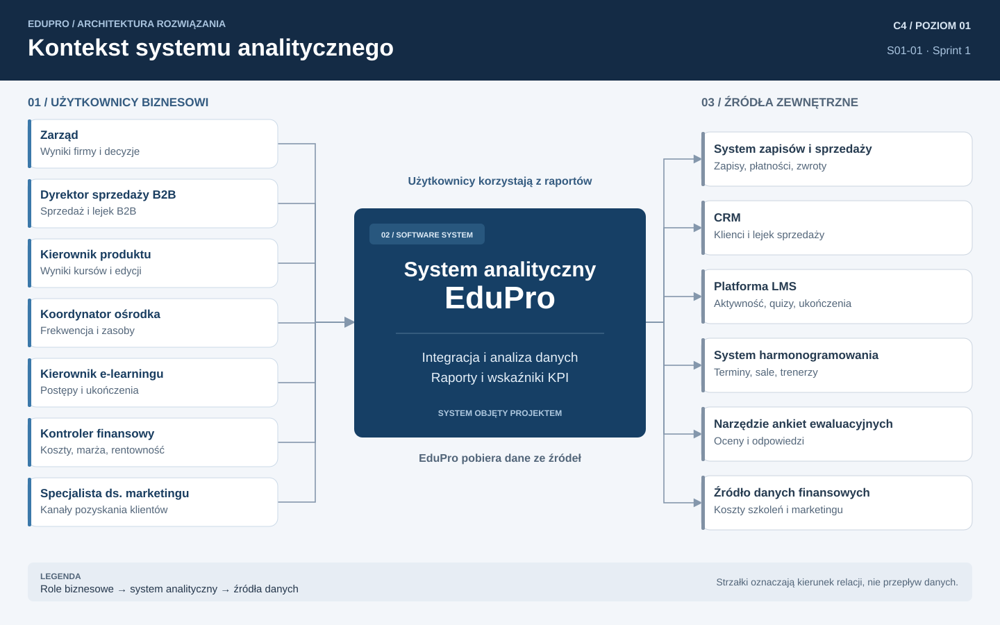

# C4 – Context: system analityczny EduPro

**Zadanie:** S01-01  
**Sprint:** 1  
**Epika:** Architektura rozwiązania  
**Priorytet:** Must have  
**Status architektury:** projekt do uzgodnienia z zespołem

## Cel i zakres

Diagram kontekstowy przedstawia system analityczny EduPro jako jedną całość, jego użytkowników biznesowych oraz zewnętrzne źródła danych. System wspiera analizę sprzedaży, realizacji szkoleń, efektywności nauki, jakości i rentowności. Diagram przedstawia docelowy kontekst, a nie stan wdrożenia w Sprincie 1.

## Diagram C4 Context

**Notacja:** diagram równoważny C4 Context. Karty po lewej oznaczają role (Person), centralna karta oznacza system (Software System), a karty po prawej oznaczają systemy lub źródła zewnętrzne. Linie zbiorcze reprezentują osobne relacje z każdym elementem; ich znaczenie opisano poniżej.

## Szczegółowe relacje użytkowników

| Użytkownik | Relacja z systemem EduPro |
|---|---|
| Zarząd | Korzysta z dashboardu zarządczego i analizuje wyniki firmy. |
| Dyrektor sprzedaży B2B | Analizuje sprzedaż firmową i lejek sprzedaży. |
| Kierownik produktu | Monitoruje wyniki kursów i edycji. |
| Koordynator ośrodka | Analizuje frekwencję i wykorzystanie zasobów. |
| Kierownik e-learningu | Analizuje postępy i ukończenia kursów. |
| Kontroler finansowy | Analizuje koszty, marżę i rentowność. |
| Specjalista ds. marketingu | Analizuje kanały pozyskania klientów. |

## Szczegółowe relacje ze źródłami

| Źródło | Dane pobierane przez EduPro |
|---|---|
| System zapisów i sprzedaży | Zapisy, zamówienia, płatności i zwroty. |
| CRM | Klienci indywidualni i firmowi, lejek sprzedaży. |
| Platforma LMS | Aktywność, postępy, quizy i ukończenia. |
| System harmonogramowania | Terminy, sale i trenerzy. |
| Narzędzie ankiet ewaluacyjnych | Oceny i odpowiedzi uczestników. |
| Źródło danych finansowych | Pliki kosztowe szkoleń i marketingu. |

## Interpretacja

- Użytkownicy korzystają z raportów systemu analitycznego; strzałki wskazują kierunek relacji korzystania.
- System analityczny pobiera dane z systemów zewnętrznych; strzałki opisują zależność pobierania, a nie fizyczny kierunek przepływu danych.
- Dane finansowe są reprezentowane jako zewnętrzne źródło plikowe, bez zakładania istnienia konkretnej aplikacji finansowej.
- PostgreSQL, Python i Power BI zostaną przedstawione na poziomie C4 Container.
- Analityka marketingowa oraz pozostałe funkcje Should/Could są elementami docelowej wizji, zależnymi od zakresu uzgodnionego z PO.

## Powiązanie z wymaganiami

Dokument „Projekt zaliczeniowy: rozwiązanie analityczne dla firmy szkoleniowej – lista wymagań”, rozdziały 1, 4, 5, 6 i 10. Diagram wspiera projektowanie realizacji R-01 (integracja źródeł), R-05 (dashboard zarządczy), R-06 (raport operacyjny) oraz pozostałych analiz. Sam diagram nie stanowi implementacji tych wymagań.

## Weryfikacja kryteriów akceptacji

| Kryterium | Sposób weryfikacji |
|---|---|
| System analityczny EduPro | Widoczny centralny prostokąt systemu EduPro |
| Najważniejsze role użytkowników | Siedem osobnych ról w grupie użytkowników, do uzgodnienia z mapą interesariuszy |
| Powiązania ze sprzedażą, LMS i finansami | Osobne elementy w grupie źródeł oraz tabela relacji |
| Zapis w dokumentacji projektu | Umieszczenie plików Markdown i SVG w tym samym katalogu repozytorium oraz sprawdzenie podglądu na GitHubie |

## Decyzje i ograniczenia

Nazwy ról i źródeł przyjęto na podstawie scenariusza projektowego; należy je porównać z ustaleniami Sprintu 0. Nie określono jeszcze protokołów integracji ani szczegółów implementacyjnych. Przed zamknięciem zadania należy wykonać przegląd diagramu zgodnie z zespołową Definition of Done.
