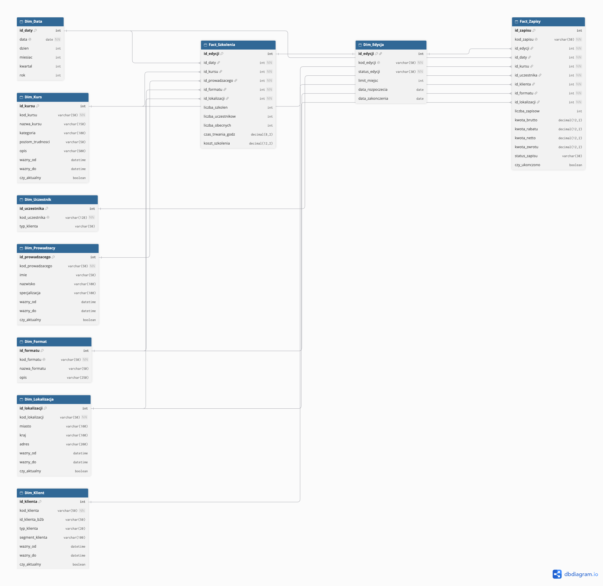

# Model danych hurtowni EduPro

**Zadanie:** S01-04 (#24)  
**Powiązanie:** R-03  
**Priorytet MoSCoW:** MUST HAVE  
**Epika:** Modelowanie danych  

## 1. Opis modelu danych

Model hurtowni danych EduPro został zaprojektowany
w oparciu o schemat gwiazdy ze współdzielonymi
wymiarami (konstelacja faktów).

Model składa się z dwóch tabel faktów oraz ośmiu
tabel wymiarów. Jego celem jest umożliwienie
wielowymiarowej analizy danych dotyczących zapisów
uczestników, klientów oraz realizacji kursów
i szkoleń.

## 2. Tabele faktów i ich ziarno

| Tabela | Ziarno |
|---|---|
| Fact_Zapisy | Pojedynczy zapis uczestnika na konkretną edycję kursu. |
| Fact_Szkolenia | Pojedyncza zaplanowana edycja kursu, niezależnie od jej statusu. |

Tabela Fact_Zapisy umożliwia analizę liczby zapisów,
przychodów, rabatów, zwrotów, statusów zapisów
oraz ukończenia kursów.

Tabela Fact_Szkolenia umożliwia analizę edycji
planowanych, zrealizowanych i odwołanych,
frekwencji, czasu trwania oraz kosztów organizacji.

## 3. Tabele wymiarów

| Tabela | Opis |
|---|---|
| Dim_Data | Informacje dotyczące daty, miesiąca, kwartału i roku. |
| Dim_Kurs | Informacje dotyczące kursów, kategorii i poziomu trudności. |
| Dim_Uczestnik | Pseudonimizowany identyfikator uczestnika oraz typ klienta. |
| Dim_Prowadzacy | Informacje dotyczące prowadzących szkolenia. |
| Dim_Format | Forma realizacji kursu: stacjonarny, online na żywo, e-learning. |
| Dim_Lokalizacja | Informacje dotyczące miejsca realizacji kursu. |
| Dim_Edycja | Identyfikator edycji, status, limit miejsc oraz daty rozpoczęcia i zakończenia. |
| Dim_Klient | Informacje dotyczące klientów B2B i B2C oraz ich identyfikatorów źródłowych. |

W przypadku kursów realizowanych w formie online
na żywo lub e-learning przewidziano rekord
techniczny w tabeli Dim_Lokalizacja, oznaczający
brak fizycznego miejsca realizacji kursu.

## 4. Relacje pomiędzy tabelami

Pomiędzy tabelami wymiarów a tabelami faktów
zastosowano klucze główne (PK) oraz klucze obce (FK).

Wymiary daty, kursu, edycji, formatu oraz lokalizacji
są współdzielone przez obie tabele faktów.

Relacje pomiędzy wymiarami a tabelami faktów mają
charakter jeden do wielu (1:N), z wyjątkiem relacji
Dim_Edycja – Fact_Szkolenia, która ze względu
na ziarno tabeli ma charakter jeden do jednego (1:1).

W tabeli Fact_Zapisy wymiar daty określa datę
zapisu uczestnika, natomiast w tabeli Fact_Szkolenia
planowaną datę rozpoczęcia edycji kursu.

Zastosowanie wspólnego wymiaru Dim_Edycja umożliwia
agregowanie przychodów i kosztów na poziomie
poszczególnych edycji bez bezpośredniego łączenia
tabel faktów.

## 5. Obsługa wskaźników KPI

| Powiązanie | Zakres | Atrybuty |
|---|---|---|
| S01-16 | Przychód netto | kwota_netto, kwota_zwrotu |
| S01-17 | Fill Rate | liczba_zapisow, status_zapisu, limit_miejsc |
| S01-19 | Marża | kwota_netto, kwota_zwrotu, koszt_szkolenia |
| S01-20 | Odwołane edycje | status_edycji |
| S01-26 | Ochrona danych osobowych | kod_uczestnika |
| INT-05 | Rabaty i zwroty | kwota_brutto, kwota_rabatu, kwota_netto, kwota_zwrotu |

### Przychód netto

Przychód netto po zwrotach obliczany jest jako
różnica pomiędzy sumą kwot netto a sumą zwrotów.

Przyjęto, że kwota netto uwzględnia rabat i nie
obejmuje VAT, a kwota zwrotu również nie obejmuje VAT.

### Fill Rate

Wskaźnik Fill Rate obliczany jest jako stosunek
liczby aktywnych zapisów do limitu miejsc,
wyrażony procentowo.

Limit miejsc uwzględniany jest jednokrotnie
dla każdej edycji. W przypadku braku limitu
lub limitu równego zero wskaźnik pozostaje
nieokreślony.

### Marża

Marża kwotowa obliczana jest jako różnica pomiędzy
przychodem netto po zwrotach a kosztem szkolenia.

Agregacja przychodów oraz kosztów odbywa się
oddzielnie na poziomie edycji z wykorzystaniem
współdzielonego wymiaru Dim_Edycja.

### Odwołane edycje

Status edycji umożliwia rozróżnienie kursów
planowanych, zrealizowanych oraz odwołanych.

Szczegółowe definicje finansowe, zasady filtrowania
statusów oraz implementacja wskaźników wymagają
potwierdzenia na etapie realizacji procesów ETL
i budowy raportów Power BI.

## 6. Ochrona danych osobowych – RODO

W celu ograniczenia zakresu przetwarzanych danych
osobowych z tabeli Dim_Uczestnik usunięto imię
oraz nazwisko uczestnika.

Zamiast bezpośrednich danych identyfikacyjnych
zastosowano pseudonimizowany kod uczestnika.

Mechanizm generowania identyfikatora zostanie
określony na etapie implementacji procesów ETL.

Pseudonimizacja stanowi element ochrony danych,
jednak nie zastępuje pozostałych wymagań RODO.

## 7. Przygotowanie pod ETL i SCD2

W tabelach wymiarów uwzględniono klucze biznesowe
oraz identyfikatory źródłowe umożliwiające mapowanie
rekordów pochodzących z systemów źródłowych.

Przykładowe identyfikatory:

- kod_kursu,
- kod_uczestnika,
- kod_prowadzacego,
- kod_formatu,
- kod_lokalizacji,
- kod_edycji,
- kod_klienta,
- id_klienta_b2b.

W wybranych wymiarach przewidziano atrybuty:

- wazny_od,
- wazny_do,
- czy_aktualny.

Atrybuty te przygotowują model do implementacji
mechanizmu Slowly Changing Dimensions typu 2
(SCD2) w ramach zadania S01-05.

Implementacja procesów ETL oraz mechanizmu
wersjonowania rekordów zostanie wykonana
w kolejnych etapach projektu.

## 8. Dalszy rozwój modelu

W kolejnych etapach projektu model zostanie
rozszerzony o tabele faktów dotyczące:

- danych z systemu LMS,
- planu sprzedaży,
- ankiet i oceny jakości szkoleń.

W ramach zadania S01-05 bezpośrednie powiązanie
id_prowadzacego w tabeli Fact_Szkolenia zostanie
zastąpione tabelą pomostową, umożliwiającą
przypisanie wielu prowadzących do jednej edycji.

## 9. Diagram ERD

Kod źródłowy modelu: [ERD.dbml](ERD.dbml)

## 10. Kryteria akceptacji

- [x] Minimum 2 tabele faktów o różnym ziarnie.
- [x] Minimum 5 tabel wymiarów.
- [x] Uwzględnienie daty, kursu, formatu i lokalizacji.
- [x] Określenie ziarna każdej tabeli faktów.
- [x] Przygotowanie diagramu ERD.
- [x] Uwzględnienie wspólnego wymiaru edycji.
- [x] Uwzględnienie klientów B2B.
- [x] Uwzględnienie pojemności i statusu edycji.
- [x] Uwzględnienie rabatów i zwrotów.
- [x] Usunięcie bezpośrednich danych osobowych uczestników.
- [x] Przygotowanie struktury pod ETL i SCD2.
- [ ] Akceptacja modelu po ponownym Code Review.

## 11. Podsumowanie

Opracowany model zawiera dwie tabele faktów,
osiem tabel wymiarów oraz trzynaście relacji.

Model uwzględnia wymagania związane ze wskaźnikami
KPI o priorytecie MUST HAVE, ograniczeniem zakresu
danych osobowych oraz dalszym rozwojem hurtowni
danych EduPro.
