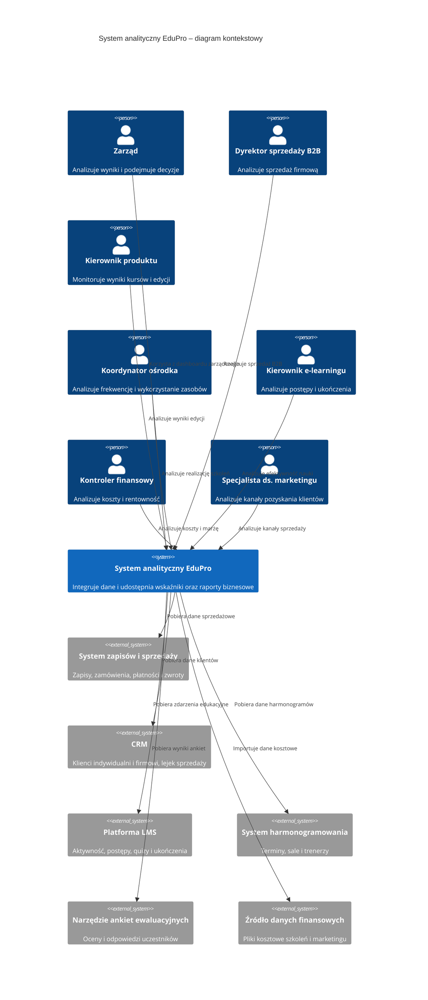

C4 – Context: system analityczny EduPro
Zadanie: S01-01  
Sprint: 1  
Epika: Architektura rozwiązania  
Priorytet: Must have  
Status architektury: projekt do uzgodnienia z zespołem
Cel i zakres
Diagram kontekstowy przedstawia system analityczny EduPro jako jedną całość, jego użytkowników biznesowych oraz zewnętrzne źródła danych. System wspiera analizę sprzedaży, realizacji szkoleń, efektywności nauki, jakości i rentowności. Diagram przedstawia docelowy kontekst, a nie stan wdrożenia w Sprincie 1.
Diagram C4 Context

Interpretacja
Użytkownicy korzystają z raportów systemu analitycznego; strzałki wskazują kierunek relacji korzystania.
System analityczny pobiera dane z systemów zewnętrznych; strzałki opisują zależność pobierania, a nie fizyczny kierunek przepływu danych.
Dane finansowe są reprezentowane jako zewnętrzne źródło plikowe, bez zakładania istnienia konkretnej aplikacji finansowej.
PostgreSQL, Python i Power BI zostaną przedstawione na poziomie C4 Container.
Analityka marketingowa oraz pozostałe funkcje Should/Could są elementami docelowej wizji, zależnymi od zakresu uzgodnionego z PO.
Powiązanie z wymaganiami
Dokument „Projekt zaliczeniowy: rozwiązanie analityczne dla firmy szkoleniowej – lista wymagań”, rozdziały 1, 4, 5, 6 i 10. Diagram wspiera projektowanie realizacji R-01 (integracja źródeł), R-05 (dashboard zarządczy), R-06 (raport operacyjny) oraz pozostałych analiz. Sam diagram nie stanowi implementacji tych wymagań.
Weryfikacja kryteriów akceptacji
Kryterium	Sposób weryfikacji
System analityczny EduPro	Widoczny centralny element System
Najważniejsze role użytkowników	Siedem elementów Person, do uzgodnienia z mapą interesariuszy
Powiązania ze sprzedażą, LMS i finansami	Elementy System_Ext oraz opisane relacje
Zapis w dokumentacji projektu	Umieszczenie tego pliku w repozytorium i sprawdzenie renderowania diagramu na GitHubie
Decyzje i ograniczenia
Nazwy ról i źródeł przyjęto na podstawie scenariusza projektowego; należy je porównać z ustaleniami Sprintu 0. Nie określono jeszcze protokołów integracji ani szczegółów implementacyjnych. Przed zamknięciem zadania należy wykonać przegląd diagramu zgodnie z zespołową Definition of Done.
